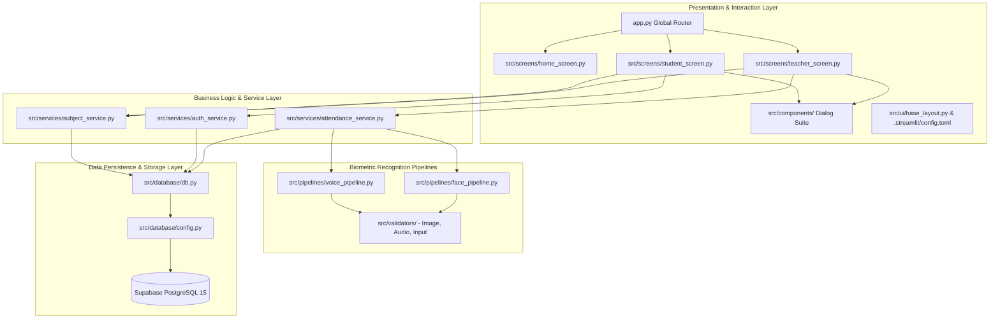

# SNAPCLASS AI — System Architecture Specification

**Document Version**: 2.2.0  
**Target Environment**: Streamlit SaaS (Option B) / Python 3.11-3.14 / Supabase PostgreSQL 15  
**Architectural Decision**: Retain and upgrade Streamlit architecture with modular service, validation, and pipeline layers.

---

## 1. High-Level System Architecture



---

## 2. Layer Responsibilities & Module Directory Structure

```text
SNAPCLASS/
├── app.py                           # Application entrypoint & query-param router
├── requirements.txt                 # Pinned dependencies
├── .streamlit/
│   ├── config.toml                  # Premium dark/light palette theme configuration
│   └── secrets.toml.example         # Template for Supabase credentials
├── docs/                            # Architectural, security, migration & QA documentation
├── src/
│   ├── config/
│   │   └── app_config.py            # Global thresholds, durations, limits, and URLs
│   ├── database/
│   │   ├── config.py                # Supabase client instantiation
│   │   └── db.py                    # Data access layer, safe queries & password hashing
│   ├── services/
│   │   ├── auth_service.py          # Authentication, password rules & composite rate limiting
│   │   ├── subject_service.py       # Subject creation, roster management, QR generation
│   │   └── attendance_service.py    # Multi-modal review drafting, mutex locking & confirmation
│   ├── pipelines/
│   │   ├── face_pipeline.py         # 128-d dlib face embeddings, Euclidean matching, twin guards
│   │   └── voice_pipeline.py        # 256-d Resemblyzer embeddings, cosine matching, close-speaker guards
│   ├── validators/
│   │   ├── input_validators.py      # Username, password, code sanitization & validation
│   │   ├── image_validators.py      # PIL image format, resolution and scaling checks
│   │   └── audio_validators.py      # Audio duration, size, and header validation
│   ├── screens/
│   │   ├── home_screen.py           # Landing page with hero section & portal selection
│   │   ├── teacher_screen.py        # Instructor workspace, tabs, subject cards, session history
│   │   └── student_screen.py        # Student portal, FaceID login, courses, attendance history
│   ├── components/
│   │   ├── header.py & footer.py    # Consistent navigation headers and footers
│   │   ├── subject_card.py          # Polished academic card component
│   │   └── dialog_*.py              # Modal dialogs for creation, photos, voice & review
│   └── ui/
│       └── base_layout.py           # Typography, container width rules & transition styles
└── tests/                           # 61-test automated test suite
    ├── unit/                        # Face, voice, auth, security & validator tests
    ├── integration/                 # Attendance and subject service integration tests
    └── workflows/                   # Full 14-step E2E lifecycle and regression tests
```

---

## 3. Core Architectural Lifecycles

### 3.1 Teacher Multi-Modal Attendance Flow
1. **Selection**: Instructor selects subject in `teacher_screen.py`.
2. **Biometric Input**:
   - Photo: Teacher uploads or captures classroom photos (`add_photos_dialog.py`).
   - Voice: Teacher records classroom roll-call audio (`dialog_voice_attendance.py`).
3. **Draft Preparation**:
   - `prepare_face_attendance_session` / `prepare_voice_attendance_session` queries only the enrolled roster from `subject_students`.
   - Embeddings are matched against enrolled student candidate vectors.
   - If 0 faces or 0 recognized speakers are found, processing halts with an informative error.
   - Ambiguous or close candidate matches are marked `NEEDS_REVIEW`.
4. **Interactive Review**:
   - An interactive review data table is rendered in `dialog_attendance_results.py`.
   - Teacher inspects AI confidence scores and can override statuses.
5. **Atomic Confirmation**:
   - `confirm_and_save_attendance` acquires `_CONFIRM_LOCK` in memory.
   - Checks `check_attendance_session_exists` against Supabase.
   - Validates teacher ownership and deduplicates payload records by `student_id`.
   - Inserts records into `attendance_logs` and releases lock.

### 3.2 Student FaceID Authentication Flow
1. Student opens FaceID login on `student_screen.py` via webcam snapshot.
2. `get_face_embeddings` extracts 128-d metric vector.
3. Vector is compared against enrolled students using `match_face_to_candidates`.
4. Authentication strictly requires `HIGH_CONFIDENCE` ($\le 0.55$).
5. On success, `login_student_by_id` initializes session state, stripping biometric embeddings.
