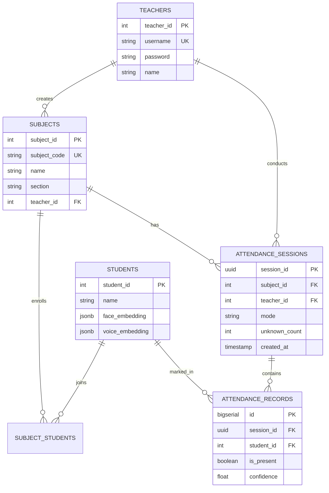

# SNAPCLASS AI — Database Architecture & Evolution Plan

**Document Version**: 2.2.0  
**Target Database**: Supabase PostgreSQL 15  
**Execution Status**: Proposed & Verified (No production DDL executed per strict rules)  

---

## 1. Current Verified Database Schema & Credentials

Direct read-only inspection of the active Supabase PostgreSQL instance verified the physical schema and client configuration:

### 1.1 Physical Schema
```sql
-- Existing Tables
teachers (
    teacher_id SERIAL PRIMARY KEY,
    username TEXT UNIQUE NOT NULL,
    password TEXT NOT NULL,
    name TEXT NOT NULL
);

students (
    student_id SERIAL PRIMARY KEY,
    name TEXT NOT NULL,
    face_embedding JSONB,      -- 128-d float array
    voice_embedding JSONB      -- 256-d float array
);

subjects (
    subject_id SERIAL PRIMARY KEY,
    subject_code TEXT NOT NULL,
    name TEXT NOT NULL,
    section TEXT NOT NULL,
    teacher_id INTEGER REFERENCES teachers(teacher_id)
);

subject_students (
    subject_id INTEGER REFERENCES subjects(subject_id) ON DELETE CASCADE,
    student_id INTEGER REFERENCES students(student_id) ON DELETE CASCADE,
    PRIMARY KEY (subject_id, student_id)
);

attendance_logs (
    id SERIAL PRIMARY KEY,
    timestamp TEXT NOT NULL,    -- ISO-8601 string
    subject_id INTEGER REFERENCES subjects(subject_id) ON DELETE CASCADE,
    student_id INTEGER REFERENCES students(student_id) ON DELETE CASCADE,
    is_present BOOLEAN NOT NULL
);
```

### 1.2 Credential & Authorization Discovery
- Inspection of `.streamlit/secrets.toml` confirmed that `SUPABASE_KEY` is a **`service_role` key** (`role: service_role`).
- In Supabase PostgreSQL, requests using `service_role` bypass Row Level Security (RLS) entirely.
- Therefore, **all tenant isolation, teacher ownership boundaries, and student profile privacy are strictly enforced at the Python application service layer (`src/services/` and `src/database/db.py`)**.
- While RLS policies are recommended for defense-in-depth, they only activate if the application migrates to Supabase Auth (`gotrue`) user JWTs or an `anon` key client.

---

## 2. Identified Schema Limitations

1. **Denormalized Session Timestamping**: `attendance_logs` currently stores individual student records grouped only by an ISO timestamp string. If network latency spans across seconds, records fragment into different groups.
2. **Missing Session Metadata**: Session-level attributes (e.g. recognition mode: photo vs voice, instructor verification notes, detected unknown face count) cannot be captured at the session level.
3. **Absence of Database Unique Constraint**: Currently, `attendance_logs` has no unique constraint on `(subject_id, student_id, timestamp)`. If two requests bypass application-level locks (e.g. concurrent workers), duplicate rows are inserted.
4. **Unindexed Foreign Keys**: For high-volume lookups, queries filtering by `teacher_id` or `subject_id` rely on sequential scans.

---

## 3. Two-Phase Database Evolution Plan

### Phase 1: Zero-Downtime Hardening for Existing Tables (Recommended Immediate Step)
Before changing the application data model, applying a unique index on `attendance_logs` guarantees PostgreSQL-level atomicity across multi-worker deployments:

```sql
-- Phase 1: Immediate Concurrency Guard
BEGIN;

-- 1. Index foreign keys for performant joins
CREATE INDEX IF NOT EXISTS idx_attendance_logs_subject_ts ON attendance_logs(subject_id, timestamp);
CREATE INDEX IF NOT EXISTS idx_attendance_logs_student ON attendance_logs(student_id);
CREATE INDEX IF NOT EXISTS idx_subjects_teacher ON subjects(teacher_id);
CREATE INDEX IF NOT EXISTS idx_subject_students_sub ON subject_students(subject_id);

-- 2. Prevent duplicate attendance writes for the same student in the same session
CREATE UNIQUE INDEX IF NOT EXISTS uq_attendance_logs_subject_student_ts 
ON attendance_logs(subject_id, student_id, timestamp);

COMMIT;
```

### Phase 2: Target Normalized Relational Architecture
Introduces dedicated `attendance_sessions` and `attendance_records` tables while providing a backward-compatible view:



---

## 4. Production Migration Script (Proposed Phase 2)

```sql
-- ====================================================================
-- MIGRATION: 20261115_02_create_attendance_sessions_and_records.sql
-- ====================================================================

BEGIN;

-- 1. Create attendance_sessions table
CREATE TABLE IF NOT EXISTS attendance_sessions (
    session_id UUID PRIMARY KEY DEFAULT gen_random_uuid(),
    subject_id INTEGER NOT NULL REFERENCES subjects(subject_id) ON DELETE CASCADE,
    teacher_id INTEGER NOT NULL REFERENCES teachers(teacher_id) ON DELETE CASCADE,
    mode VARCHAR(20) NOT NULL DEFAULT 'face', -- 'face' or 'voice'
    unknown_faces_count INTEGER DEFAULT 0,
    created_at TIMESTAMPTZ NOT NULL DEFAULT NOW()
);

-- 2. Create attendance_records table with strict uniqueness
CREATE TABLE IF NOT EXISTS attendance_records (
    id BIGSERIAL PRIMARY KEY,
    session_id UUID NOT NULL REFERENCES attendance_sessions(session_id) ON DELETE CASCADE,
    student_id INTEGER NOT NULL REFERENCES students(student_id) ON DELETE CASCADE,
    is_present BOOLEAN NOT NULL DEFAULT FALSE,
    confidence_score FLOAT,
    created_at TIMESTAMPTZ NOT NULL DEFAULT NOW(),
    CONSTRAINT uq_session_student UNIQUE (session_id, student_id)
);

-- 3. Add Performance Indexes
CREATE INDEX IF NOT EXISTS idx_subjects_teacher_id ON subjects(teacher_id);
CREATE INDEX IF NOT EXISTS idx_subject_students_subject_id ON subject_students(subject_id);
CREATE INDEX IF NOT EXISTS idx_subject_students_student_id ON subject_students(student_id);
CREATE INDEX IF NOT EXISTS idx_attendance_sessions_subject ON attendance_sessions(subject_id, created_at DESC);
CREATE INDEX IF NOT EXISTS idx_attendance_records_student ON attendance_records(student_id);

-- 4. Backward Compatibility View
CREATE OR REPLACE VIEW attendance_logs_compat AS
SELECT
    ar.id,
    to_char(s.created_at, 'YYYY-MM-DD"T"HH24:MI:SS') AS timestamp,
    s.subject_id,
    ar.student_id,
    ar.is_present
FROM attendance_records ar
JOIN attendance_sessions s ON ar.session_id = s.session_id;

COMMIT;
```

---

## 5. Rollback Procedures

### Rollback Phase 1:
```sql
BEGIN;
DROP INDEX IF EXISTS uq_attendance_logs_subject_student_ts;
DROP INDEX IF EXISTS idx_attendance_logs_subject_ts;
DROP INDEX IF EXISTS idx_attendance_logs_student;
DROP INDEX IF EXISTS idx_subjects_teacher;
DROP INDEX IF EXISTS idx_subject_students_sub;
COMMIT;
```

### Rollback Phase 2:
```sql
BEGIN;
DROP VIEW IF EXISTS attendance_logs_compat;
DROP TABLE IF EXISTS attendance_records CASCADE;
DROP TABLE IF EXISTS attendance_sessions CASCADE;
DROP INDEX IF EXISTS idx_subjects_teacher_id;
DROP INDEX IF EXISTS idx_subject_students_subject_id;
DROP INDEX IF EXISTS idx_subject_students_student_id;
COMMIT;
```
