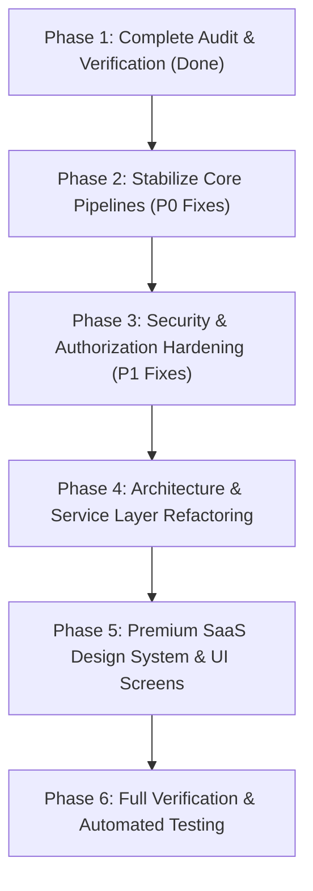

# SNAPCLASS AI — Comprehensive Technical Audit & Upgrade Blueprint

**Audit Date**: November 2026  
**Auditor**: Senior Software Architect & Application Security Engineer  
**Branch**: `feature/snapclass-premium-upgrade`  
**Current Live App**: https://snapclass-ai-attendence-system.streamlit.app/  
**Repository**: https://github.com/Ritikgupta-tech/snapclass-ai.git  
**Architecture Decision**: Option B — Retain and Upgrade Streamlit  

---

## Executive Summary

SNAPCLASS AI is an AI-powered attendance management platform designed for educational institutions. The application integrates computer vision (dlib face detection & 128-dimensional biometric embeddings) and speech processing (Resemblyzer voice embeddings & Librosa audio processing) with a Streamlit interface and Supabase/PostgreSQL backend.

While the core conceptual workflows (teacher login, subject creation, student enrollment, classroom photo analysis, audio verification, and attendance logging) are functional in proof-of-concept scenarios, a comprehensive repository audit identified **critical architectural bugs, stability crashes, security vulnerabilities, unscoped biometric classification, and UI/UX deficits** that prevent it from operating as a reliable commercial EdTech SaaS.

This document details every inspected subsystem, identifies root causes, calculates operational severities, and defines the phased implementation strategy for transforming SNAPCLASS AI into a resilient, secure, and visually premium SaaS application.

---

## 1. Existing Architecture & Inventory

### 1.1 Technology Stack
- **Frontend & App Framework**: Streamlit 1.67.0
- **Runtime**: Python 3.14.6
- **Database / BaaS**: Supabase (PostgreSQL 15 via `supabase-py` 2.34.1 / PostgREST)
- **Computer Vision**: `dlib-bin` 20.0.1.post1, `face_recognition_models` 0.3.0, `scikit-learn` 1.9.1, `Pillow` 13.0.0, `numpy` 2.5.4
- **Audio & Speech**: `Resemblyzer` 0.1.4, `librosa` 1.0.1, `soundfile` 0.14.0, `torch` 2.15.0
- **Security & QR**: `bcrypt` 5.0.0, `segno` 1.6.6

### 1.2 Repository Structure
```
SNAPCLASS/
├── .streamlit/
│   └── secrets.toml          # Supabase credentials (SUPABASE_URL, SUPABASE_KEY)
├── src/
│   ├── components/
│   │   ├── dialog_add_photo.py          # Photo capture & multi-file upload
│   │   ├── dialog_attendance_results.py # Attendance review & save dialog
│   │   ├── dialog_auto_enroll.py        # QR join auto-enrollment modal
│   │   ├── dialog_create_subject.py     # Subject creation modal
│   │   ├── dialog_enroll.py             # Student manual subject enrollment
│   │   ├── dialog_share_subject.py      # QR code and share link modal
│   │   ├── dialog_voice_attendance.py   # Audio recording & speech recognition
│   │   ├── footer.py                    # Global application footers
│   │   ├── header.py                    # Global application headers
│   │   └── subject_card.py              # Visual subject presentation card
│   ├── database/
│   │   ├── config.py                    # Supabase client instantiation
│   │   └── db.py                        # Database access queries & bcrypt helpers
│   ├── pipelines/
│   │   ├── face_pipeline.py             # dlib face embeddings & SVM classifier
│   │   └── voice_pipeline.py            # Resemblyzer speaker similarity
│   ├── screens/
│   │   ├── home_screen.py               # Public landing screen
│   │   ├── student_screen.py            # Student portal & biometric enrollment
│   │   └── teacher_screen.py            # Teacher dashboard & attendance hub
│   └── ui/
│       └── base_layout.py               # Custom CSS injection & styling
├── app.py                               # Application entrypoint & routing
└── requirements.txt                     # Package dependencies
```

### 1.3 Verified Live Database Schema
Direct inspection of the live Supabase PostgreSQL schema verified the following existing tables and columns:

| Table | Primary Key | Columns | Relationships / Constraints |
|---|---|---|---|
| `teachers` | `teacher_id` | `teacher_id` (int), `username` (text), `password` (text), `name` (text) | Unique `username` |
| `students` | `student_id` | `student_id` (int), `name` (text), `face_embedding` (json/array), `voice_embedding` (json/array) | Biometric vectors stored as JSON arrays |
| `subjects` | `subject_id` | `subject_id` (int), `subject_code` (text), `name` (text), `section` (text), `teacher_id` (int) | FK to `teachers.teacher_id` |
| `subject_students` | Composite | `subject_id` (int), `student_id` (int) | FKs to `subjects.subject_id`, `students.student_id` |
| `attendance_logs` | `id` | `id` (int), `timestamp` (text/timestamptz), `subject_id` (int), `student_id` (int), `is_present` (bool) | FKs to `subjects.subject_id`, `students.student_id` |

---

## 2. Comprehensive Defect Analysis

### 2.1 P0 — Critical Crashes, Runtime Failures & Broken Workflows

#### ISSUE-P0-01: Voice Attendance Unhandled NoneType Crash
- **File & Function**: [src/components/dialog_voice_attendance.py#L38](file:///c:/Users/DELL/Desktop/SNAPCLASS/src/components/dialog_voice_attendance.py#L38)
- **Severity**: P0 — Critical Crash
- **Impact**: When a teacher clicks "Analyze Audio" without recording audio first or before audio is uploaded, the app throws an unhandled exception: `AttributeError: 'NoneType' object has no attribute 'read'`, crashing the Streamlit session.
- **Root Cause**: `audio_data = st.audio_input(...)` returns `None` if unrecorded. `audio_bytes = audio_data.read()` executes unconditionally without validation.
- **Proposed Solution**: Implement strict defensive validation. Check `if not audio_data: st.warning(...)` and return cleanly. Validate audio size (non-zero bytes, max size limit) and duration.

#### ISSUE-P0-02: Silent False Absent Logging on Voice Pipeline Failures
- **File & Function**: [src/components/dialog_voice_attendance.py#L40-L65](file:///c:/Users/DELL/Desktop/SNAPCLASS/src/components/dialog_voice_attendance.py#L40-L65)
- **Severity**: P0 — Data Corruption / Broken Logic
- **Impact**: If audio processing fails, if audio contains silence/noise, or if no speakers match the threshold, `process_bulk_audio` returns `{}`. The code proceeds to construct `attendance_to_log` with `is_present = False` for **every single enrolled student**. When the teacher confirms, the system marks the entire class absent due to a failed AI step.
- **Root Cause**: Missing verification of recognition outcome before formatting attendance records.
- **Proposed Solution**: Verify recognition yield. If `detected_scores` is empty or below confidence, alert the teacher that no voices were recognized. Prevent confirming attendance when zero identifications occurred, and offer Discard/Retry options.

#### ISSUE-P0-03: Subject Card Loop Closure & Indentation Bug
- **File & Function**: [src/screens/teacher_screen.py#L216-L234](file:///c:/Users/DELL/Desktop/SNAPCLASS/src/screens/teacher_screen.py#L216-L234) (`teacher_tab_manage_subjects`)
- **Severity**: P0 — Broken Feature
- **Impact**: In the teacher dashboard "Manage Subjects" tab, only the **very last** subject is ever displayed. Furthermore, the `share_btn()` callback captures `sub` via closure from the outer scope, meaning if multiple subjects were rendered, all share buttons would target the last subject.
- **Root Cause**: The `for sub in subjects:` loop only encloses the `stats = [...]` declaration. `def share_btn():` and `subject_card(...)` are indented outside the loop.
- **Proposed Solution**: Properly indent `subject_card` and its action callback within the iteration. Use explicit parameter passing (`def share_btn(s=sub): ...`) and unique element keys per subject.

#### ISSUE-P0-04: Face Recognition Single-Class Crash & Global Unscoped Classification
- **File & Function**: [src/pipelines/face_pipeline.py#L40-L106](file:///c:/Users/DELL/Desktop/SNAPCLASS/src/pipelines/face_pipeline.py#L40-L106) (`get_trained_model`, `predict_attendance`)
- **Severity**: P0 — Architectural Defect & False Matches
- **Impact**:
  1. `SVC(kernel='linear')` requires at least 2 distinct target classes. When a database has only 1 student (or 1 class), `clf.fit(X, y)` raises `ValueError`. The blanket `except ValueError: pass` leaves `clf` completely unfitted while caching `{'clf': clf}`.
  2. In `predict_attendance`, `clf.predict()` partitions the entire 128-dimensional embedding space. An SVM classifier does not have an "unknown" class. It forces any detected face (including strangers or students from other classes) to be classified as one of the database students.
  3. `get_all_students()` fetches the entire institution database across all teachers and classes. Students from Subject B can be falsely detected in Subject A.
  4. Single Euclidean distance check `student_embedding = X_train[y_train.index(predicted_id)]` only checks against the *first* sample of that student, ignoring variations.
  5. Global `@st.cache_resource` on `get_trained_model()` without arguments creates a shared cache across all users and subjects, leading to cross-tenant data leakage. Calling `train_classifier()` clears all resource caches including dlib models and voice encoder.
- **Proposed Solution**: 
  - Restrict candidate matching strictly to students enrolled in the selected subject.
  - Implement direct 1-to-1 cosine/Euclidean distance matching against enrolled candidate embeddings rather than a global monolithic multi-class SVM.
  - Support single-student, multi-student, and zero-student cases cleanly.
  - Calibrate threshold (default 0.6 distance / cosine similarity >= 0.75), explicitly classify unknown faces, and surface them in a "Needs Review" category.
  - Cache dlib/neural network weights separately from student biometric data.

#### ISSUE-P0-05: Hardcoded Deployment Domain & Malformed QR Join Link
- **File & Function**: [src/components/dialog_share_subject.py#L9-L10](file:///c:/Users/DELL/Desktop/SNAPCLASS/src/components/dialog_share_subject.py#L9-L10)
- **Severity**: P0 — Broken Feature
- **Impact**: QR code and share link generate `snapclass-main.streamlit.app/?join-code={subject_code}` without `https://` protocol and pointing to an outdated/wrong deployment URL. When scanned by mobile devices, the URL fails or leads to the wrong application.
- **Root Cause**: Hardcoded domain string literal.
- **Proposed Solution**: Provide centralized configuration for canonical application URL (`APP_BASE_URL`) with automatic detection via Streamlit query/host headers where possible, always including proper protocol scheme (`https://`).

#### ISSUE-P0-06: File Uploader & Camera Re-trigger Infinite Duplication
- **File & Function**: [src/components/dialog_add_photo.py#L32-L47](file:///c:/Users/DELL/Desktop/SNAPCLASS/src/components/dialog_add_photo.py#L32-L47)
- **Severity**: P0 — Memory Leak & Duplicate Records
- **Impact**: Uploading files or capturing camera snapshots calls `st.session_state.attendance_images.append(...)` and then `st.rerun()`. On rerun, the file uploader and camera widgets retain the uploaded files, appending them again and again on successive runs.
- **Root Cause**: Streamlit widget values persist until cleared; unconditional appends on every script execution cause duplication.
- **Proposed Solution**: Track file signatures/hashes in session state, append each unique file only once, and provide explicit "Add to Session" and "Clear" actions.

#### ISSUE-P0-07: Duplicate Attendance Confirmation & Race Conditions
- **File & Function**: [src/components/dialog_attendance_results.py#L22-L31](file:///c:/Users/DELL/Desktop/SNAPCLASS/src/components/dialog_attendance_results.py#L22-L31)
- **Severity**: P0 — Data Corruption
- **Impact**: Multiple rapid clicks on "Confirm & Save" fire duplicate insert transactions into `attendance_logs`. If network latency occurs, teachers inadvertently create duplicate attendance sets. Furthermore, if `create_attendance` throws an error, the error is swallowed into `st.error('Sync failed!')` without preserving review state.
- **Root Cause**: Lack of idempotency token, save locks, or state protection.
- **Proposed Solution**: Implement an `attendance_session_id` UUID, enforce a saving state lock (`st.session_state.is_saving`), validate non-empty payload, and provide transaction-safe inserts.

#### ISSUE-P0-08: Duplicate Streamlit Element Keys
- **File & Function**: [src/screens/teacher_screen.py#L48, #L306, #L361](file:///c:/Users/DELL/Desktop/SNAPCLASS/src/screens/teacher_screen.py#L48), [src/screens/student_screen.py#L25, #L105](file:///c:/Users/DELL/Desktop/SNAPCLASS/src/screens/student_screen.py#L25)
- **Severity**: P0 — Streamlit Crash
- **Impact**: Multiple buttons across screens reuse `key='loginbackbtn'`. Streamlit raises `StreamlitDuplicateElementKey` when components co-exist during page transitions.
- **Proposed Solution**: Standardize unique, contextual keys across all widgets.

---

### 2.2 P1 — Security, Authorization & Data Integrity Deficits

#### ISSUE-P1-01: Sensitive Credential & Biometric Exposure in Session State
- **File & Function**: [src/database/db.py#L28-L33](file:///c:/Users/DELL/Desktop/SNAPCLASS/src/database/db.py#L28-L33) (`teacher_login`), [src/screens/teacher_screen.py#L295](file:///c:/Users/DELL/Desktop/SNAPCLASS/src/screens/teacher_screen.py#L295), [src/screens/student_screen.py#L135](file:///c:/Users/DELL/Desktop/SNAPCLASS/src/screens/student_screen.py#L135)
- **Severity**: P1 — High Security Risk
- **Impact**: `teacher_login` executes `select("*")` on the `teachers` table and returns the raw bcrypt password hash. The password hash is stored in `st.session_state.teacher_data`. Similarly, `student_data` stores 128-float face embeddings and 256-float voice embeddings in plain session state.
- **Root Cause**: Unscoped `select("*")` queries.
- **Proposed Solution**: Explicitly select only necessary columns (`teacher_id`, `username`, `name`). Strip password hashes and biometric embeddings before returning user models to the application layer.

#### ISSUE-P1-02: Unenforced Teacher Authorization Scoping
- **File & Function**: [src/database/db.py#L95-L97](file:///c:/Users/DELL/Desktop/SNAPCLASS/src/database/db.py#L95-L97), [src/screens/teacher_screen.py#L156](file:///c:/Users/DELL/Desktop/SNAPCLASS/src/screens/teacher_screen.py#L156)
- **Severity**: P1 — Authorization Bypass
- **Impact**: In several workflows, queries directly accept `subject_id` without verifying that the subject actually belongs to the authenticated `teacher_id`. A malicious user manipulating widget state could take attendance or inspect students of another teacher's subject.
- **Root Cause**: Missing ownership checks on database operations.
- **Proposed Solution**: Enforce teacher ownership verification in service layer methods before querying or writing subject data.

#### ISSUE-P1-03: Lack of Input Sanitization & Password Complexity Rules
- **File & Function**: [src/screens/teacher_screen.py#L341-L355](file:///c:/Users/DELL/Desktop/SNAPCLASS/src/screens/teacher_screen.py#L341-L355) (`register_teacher`)
- **Severity**: P1 — Credential Security
- **Impact**: Teachers can register with single-character passwords. There is no rate-limiting on login or registration attempts.
- **Root Cause**: Minimal validation logic.
- **Proposed Solution**: Implement a robust validator: minimum 8 characters, required character diversity, username sanitization, and session-based rate limiting on authentication attempts.

#### ISSUE-P1-04: Student FaceID Spoofing Vulnerability (No Liveness Verification)
- **File & Function**: [src/screens/student_screen.py#L114-L138](file:///c:/Users/DELL/Desktop/SNAPCLASS/src/screens/student_screen.py#L114-L138)
- **Severity**: P1 — Biometric Security Risk
- **Impact**: Student login relies entirely on a single camera snapshot matched against stored embeddings. There is no challenge-response, blink detection, or 3D depth check. A static photograph on a smartphone can bypass login.
- **Proposed Solution**: Document the limitation explicitly. Add an optional confirmation factor (e.g. Student ID verification / PIN) and transparent security notices advising that 2D camera capture is not spoof-proof without specialized hardware.

#### ISSUE-P1-05: Absence of Structured Attendance Session Modeling
- **File & Function**: [src/database/db.py#L91-L94](file:///c:/Users/DELL/Desktop/SNAPCLASS/src/database/db.py#L91-L94), `attendance_logs` table
- **Severity**: P1 — Data Integrity
- **Impact**: Attendance logs are written as individual row items with a loose string `timestamp`. If an attendance run for 50 students takes 2 seconds or if timestamps vary by milliseconds, records fragment into different groups in `groupby(['ts_group'])`.
- **Proposed Solution**: Introduce a logical `attendance_sessions` structure with `session_id`, `subject_id`, `teacher_id`, `session_date`, `session_type` (face/voice), and link `attendance_records` to the session ID.

---

### 2.3 P2 — Performance & Operational Bottlenecks

#### ISSUE-P2-01: Full Database Scans in `get_all_students()`
- **File & Function**: [src/database/db.py#L36-L38](file:///c:/Users/DELL/Desktop/SNAPCLASS/src/database/db.py#L36-L38)
- **Severity**: P2 — Scalability Bottleneck
- **Impact**: `get_all_students()` executes `select("*")` on the entire `students` table, returning all biometric embeddings across the institution on every login check and model reload. At 1,000 students, this downloads tens of megabytes of raw floats on every run.
- **Proposed Solution**: Parameterize student lookups. For attendance, fetch only students enrolled in the specific subject (`subject_students`). For login, search by identifier or filter appropriately.

#### ISSUE-P2-02: Wholesale Resource Cache Invalidation
- **File & Function**: [src/pipelines/face_pipeline.py#L70-L73](file:///c:/Users/DELL/Desktop/SNAPCLASS/src/pipelines/face_pipeline.py#L70-L73) (`train_classifier`)
- **Severity**: P2 — Latency Spike
- **Impact**: `st.cache_resource.clear()` wipes all cached resources in the process, forcing dlib shape predictors (99MB model file) and Resemblyzer voice models to be re-read from disk and re-initialized into memory on the next user request.
- **Proposed Solution**: Separate model weight caching from enrollment candidate caching. Never wipe static neural network weights when student rosters update.

#### ISSUE-P2-03: Unbounded Image Resizing & Processing
- **File & Function**: [src/screens/teacher_screen.py#L145-L147](file:///c:/Users/DELL/Desktop/SNAPCLASS/src/screens/teacher_screen.py#L145-L147)
- **Severity**: P2 — Memory & CPU Overload
- **Impact**: Classroom photos uploaded at full 24-48MP smartphone resolutions are passed directly into dlib's `get_frontal_face_detector(image, 1)`. Upsampling a 48MP image consumes gigabytes of RAM and takes 15-30 seconds per photo.
- **Proposed Solution**: Preprocess and normalize classroom images: resize to standard analytical resolutions (e.g. max 1920px on the longest edge while maintaining aspect ratio) before passing to face detector.

---

### 2.4 P3 — Design System, UI/UX & Code Quality Deficits

#### ISSUE-P3-01: Informal Visual Style & Novelty Typography
- **File & Function**: [src/ui/base_layout.py#L42-L109](file:///c:/Users/DELL/Desktop/SNAPCLASS/src/ui/base_layout.py#L42-L109), [src/components/header.py](file:///c:/Users/DELL/Desktop/SNAPCLASS/src/components/header.py)
- **Severity**: P3 — Visual Polish
- **Impact**: Injecting aggressive CSS (`background: #5865F2 !important`, Discord purple, neon pink `#EB459E`, 5rem column border-radius, and `'Climate Crisis'` novelty block font) gives the application an informal college project aesthetic. Line 63 contains broken CSS: `line-height:1.1 1important;`.
- **Proposed Solution**: Implement a refined SaaS design system (inspired by Linear, Stripe, and Vercel): clean neutral dark/light surfaces, modern typography (Inter/Outfit), subtle borders (`rgba(255,255,255,0.08)` / slate), refined shadows, and proper Streamlit container cards (`st.container(border=True)`).

#### ISSUE-P3-02: Primitive Landing Page
- **File & Function**: [src/screens/home_screen.py](file:///c:/Users/DELL/Desktop/SNAPCLASS/src/screens/home_screen.py)
- **Severity**: P3 — Product Presentation
- **Impact**: The landing page consists only of two cartoon mascot cards and login buttons. It lacks any product explanation, feature showcases, workflow previews, or institutional trust factors.
- **Proposed Solution**: Transform into a premium SaaS landing experience with a hero header, value propositions, step-by-step workflow guide, biometric security disclosures, and direct role-based entrypoints.

#### ISSUE-P3-03: Non-Editable Attendance Review Dialog
- **File & Function**: [src/components/dialog_attendance_results.py#L9-L32](file:///c:/Users/DELL/Desktop/SNAPCLASS/src/components/dialog_attendance_results.py#L9-L32)
- **Severity**: P3 — Core Workflow Usability
- **Impact**: Teachers are shown a static `st.dataframe`. If the AI misidentifies an ambiguous face or misses a student who was present, the teacher has no way to toggle the student's status before saving.
- **Proposed Solution**: Enable interactive attendance review using editable statuses (`st.data_editor` or status pills), allowing teachers to adjust suggestions prior to final confirmation.

#### ISSUE-P3-04: Blank Empty States in Dashboards
- **File & Function**: [src/screens/teacher_screen.py#L245](file:///c:/Users/DELL/Desktop/SNAPCLASS/src/screens/teacher_screen.py#L245)
- **Severity**: P3 — UX Flow
- **Impact**: When a teacher has no attendance records, the page simply renders nothing, leaving a confusing blank area.
- **Proposed Solution**: Render informative, beautifully styled empty states with contextual icons and actionable guidance.

---

## 3. Recommended Implementation Sequence



1. **Phase 2 — Stabilize Core Pipelines**:
   - Repair `voice_pipeline.py` & `dialog_voice_attendance.py`: defensive audio validation, duration bounds, prevent false absent records on recognition failure.
   - Repair `face_pipeline.py`: replace global unscoped SVM with subject-scoped candidate cosine/Euclidean matching, robust unknown-face handling, decouple weight caching from data caching.
   - Fix loop closure & indentation bug in `teacher_screen.py`.
   - Fix file uploader and camera rerun duplicate loop in `dialog_add_photo.py`.
   - Fix hardcoded domain and malformed QR links in `dialog_share_subject.py`.
   - Add idempotency protection to attendance confirmation.

2. **Phase 3 — Security, Data Protection & Database Scoping**:
   - Omit password hashes and biometric embeddings from general query responses.
   - Enforce teacher ownership checks on all subject queries.
   - Implement password complexity validation and login rate-limiting.
   - Establish logical attendance session modeling.

3. **Phase 4 — Service Layer & Code Quality**:
   - Modularize into `src/services/`, `src/validators/`, and `src/config/`.
   - Standardize typing and docstrings.
   - Ensure clean session state lifecycle management.

4. **Phase 5 — Premium UI & Design System**:
   - Modernize visual styling via `.streamlit/config.toml` and sleek typography.
   - Rebuild Public Landing Page with clear product narrative.
   - Rebuild Teacher Dashboard with real operational metrics and subject cards.
   - Upgrade Attendance Workspace with interactive verification and review controls.
   - Rebuild Student Dashboard with attendance stats and clear enrollment status.

5. **Phase 6 — Testing & Verification**:
   - Create unit tests for face pipeline, voice pipeline, validators, and auth services.
   - Run local Streamlit server checks via agent API / headless tests.
   - Verify every teacher and student workflow end-to-end.
