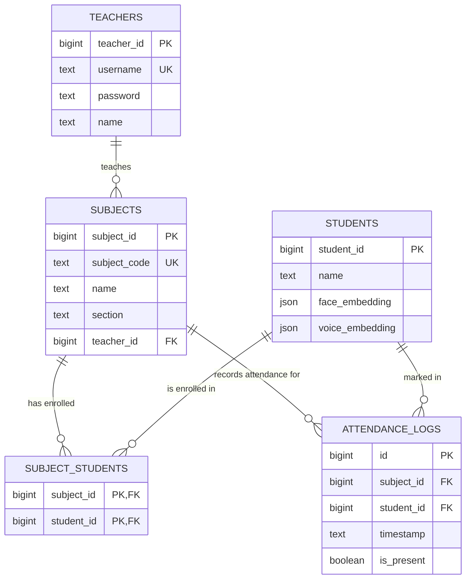

# SNAPCLASS AI — Database Design & Schema Specification

**Course:** B.Tech Computer Science & Engineering  
**Project:** SNAPCLASS AI  
**Database Engine:** PostgreSQL 15 (Supabase Managed Cloud Instance)  
**ORM / Client Layer:** PostgREST Python Client (`supabase` v2.34.1 / `postgrest` v2.34.1)  
**Document Classification:** Technical Database Design Specification  

---

## 1. Overview of Database Architecture

SNAPCLASS AI utilizes a cloud-hosted relational PostgreSQL database managed via Supabase. The database architecture enforces relational integrity, referential constraints, and transactional consistency while accommodating multi-dimensional biometric vector payloads.

Communication between the Streamlit application runtime and PostgreSQL occurs over HTTPS via Supabase PostgREST endpoints. Queries are constructed programmatically using the Python Supabase SDK (`src/database/db.py`), which abstracts parameterized SQL queries, prevents SQL injection vulnerabilities, and maps relational rows directly into native Python typed dictionaries.

---

## 2. Verified Live Database Schema (Active Tables)

Based on comprehensive static code analysis of `src/database/db.py`, the active production database consists of **five relational tables**:

```text
+------------------+         +------------------+
|     teachers     |         |     students     |
+------------------+         +------------------+
|  teacher_id (PK) |         |  student_id (PK) |
|  username (UK)   |         |  name            |
|  password        |         |  face_embedding  |
|  name            |         |  voice_embedding |
+--------+---------+         +--------+---------+
         |                            |
         | 1:N                        | 1:N
         v                            v
+------------------+         +------------------+
|     subjects     | 1:N     | subject_students |
+------------------+-------->+------------------+
|  subject_id (PK) |         | subject_id (PK,FK)
|  subject_code(UK)|         | student_id (PK,FK)
|  name            |         +------------------+
|  section         |                  ^
|  teacher_id (FK) |                  | 1:N
+--------+---------+                  |
         |                            |
         | 1:N                        |
         v                            v
+-----------------------------------------------+
|                attendance_logs                |
+-----------------------------------------------+
|  id (PK)                                      |
|  subject_id (FK)                              |
|  student_id (FK)                              |
|  timestamp                                    |
|  is_present                                   |
+-----------------------------------------------+
```

---

### 2.1 Table: `teachers`
Stores faculty user credentials and profiles. Passwords are encrypted before insertion using salted bcrypt hashes.

| Column Name | PostgreSQL Data Type | Constraints / Modifiers | Description |
| :--- | :--- | :--- | :--- |
| `teacher_id` | `BIGINT` or `INT8` | `PRIMARY KEY`, `GENERATED ALWAYS AS IDENTITY` | Unique sequential identifier for each instructor account. |
| `username` | `TEXT` | `NOT NULL`, `UNIQUE` | Case-insensitive normalized login handle (e.g., `ananya_roy`). |
| `password` | `TEXT` | `NOT NULL` | Cryptographic Blowfish bcrypt hash string (60 characters). |
| `name` | `TEXT` | `NOT NULL` | Legal full name displayed on dashboards and course syllabi. |

**Queries operating on `teachers`:**
- Check existence: `supabase.table("teachers").select("teacher_id").eq("username", username).execute()`
- Authentication: `supabase.table("teachers").select("teacher_id, username, password, name").eq("username", username).execute()`
- Registration: `supabase.table("teachers").insert({"username": ..., "password": hash_pass(pwd), "name": ...}).execute()`
- Profile lookup: `supabase.table("teachers").select("teacher_id, username, name").eq("teacher_id", teacher_id).execute()`

---

### 2.2 Table: `students`
Stores student biometric profiles and identifiers. Biometric vectors are serialized as JSON arrays or PostgreSQL numeric arrays.

| Column Name | PostgreSQL Data Type | Constraints / Modifiers | Description |
| :--- | :--- | :--- | :--- |
| `student_id` | `BIGINT` or `INT8` | `PRIMARY KEY`, `GENERATED ALWAYS AS IDENTITY` | Unique institutional identification number for the student. |
| `name` | `TEXT` | `NOT NULL` | Student full legal name. |
| `face_embedding`| `JSON` or `FLOAT8[]` | `NULLABLE` | 128-dimensional dlib normalized metric vector ($128 \times 64\text{-bit}$ floats). |
| `voice_embedding`| `JSON` or `FLOAT8[]`| `NULLABLE` | 256-dimensional Resemblyzer normalized speaker vector ($256 \times 64\text{-bit}$ floats). |

**Queries operating on `students`:**
- Bulk candidate lookup: `supabase.table("students").select("student_id, name, face_embedding, voice_embedding").execute()`
- Lightweight candidate lookup (UI): `supabase.table("students").select("student_id, name").execute()`
- Registration: `supabase.table("students").insert({"name": ..., "face_embedding": [...], "voice_embedding": [...]}).execute()`
- Lookup by ID: `supabase.table("students").select(...).eq("student_id", student_id).execute()`

---

### 2.3 Table: `subjects`
Stores academic course units managed by instructors.

| Column Name | PostgreSQL Data Type | Constraints / Modifiers | Description |
| :--- | :--- | :--- | :--- |
| `subject_id` | `BIGINT` or `INT8` | `PRIMARY KEY`, `GENERATED ALWAYS AS IDENTITY` | Unique internal surrogate key for the academic course. |
| `subject_code` | `TEXT` | `NOT NULL`, `UNIQUE` | Normalized uppercase institutional code (e.g., `CS101`, `BSC201`). |
| `name` | `TEXT` | `NOT NULL` | Academic title (e.g., `Data Structures & Algorithms`). |
| `section` | `TEXT` | `NOT NULL` | Cohort descriptor (e.g., `Section B1 3rd Year`). |
| `teacher_id` | `BIGINT` | `NOT NULL`, `FOREIGN KEY` | References `teachers(teacher_id)` with `ON DELETE CASCADE`. |

**Queries operating on `subjects`:**
- Lookup by code: `supabase.table("subjects").select("subject_id, subject_code, name, section, teacher_id").eq("subject_code", code).execute()`
- Create course: `supabase.table("subjects").insert({"subject_code": ..., "name": ..., "section": ..., "teacher_id": ...}).execute()`
- Teacher courses with aggregations: `supabase.table("subjects").select("subject_id, subject_code, name, section, teacher_id, subject_students(count), attendance_logs(timestamp)").eq("teacher_id", teacher_id).order("subject_id", desc=True).execute()`
- Ownership validation: `supabase.table("subjects").select("subject_id").eq("subject_id", subject_id).eq("teacher_id", teacher_id).execute()`

---

### 2.4 Table: `subject_students` (Junction Table)
Implements the Many-to-Many ($M:N$) enrollment relationship between `students` and `subjects`.

| Column Name | PostgreSQL Data Type | Constraints / Modifiers | Description |
| :--- | :--- | :--- | :--- |
| `subject_id` | `BIGINT` | `NOT NULL`, `PRIMARY KEY`, `FOREIGN KEY` | References `subjects(subject_id)` with `ON DELETE CASCADE`. |
| `student_id` | `BIGINT` | `NOT NULL`, `PRIMARY KEY`, `FOREIGN KEY` | References `students(student_id)` with `ON DELETE CASCADE`. |

**Queries operating on `subject_students`:**
- Check enrollment: `supabase.table("subject_students").select("subject_id").eq("subject_id", subject_id).eq("student_id", student_id).execute()`
- Enroll student: `supabase.table("subject_students").insert({"student_id": ..., "subject_id": ...}).execute()`
- Unenroll student: `supabase.table("subject_students").delete().eq("student_id", student_id).eq("subject_id", subject_id).execute()`
- Fetch student subjects: `supabase.table("subject_students").select("subject_id, student_id, subjects(...)").eq("student_id", student_id).execute()`
- Fetch course roster: `supabase.table("subject_students").select("subject_id, student_id, students(...)").eq("subject_id", subject_id).execute()`

---

### 2.5 Table: `attendance_logs`
Stores historical verified attendance transactions. Each row represents the attendance outcome for one student during a specific classroom session.

| Column Name | PostgreSQL Data Type | Constraints / Modifiers | Description |
| :--- | :--- | :--- | :--- |
| `id` | `BIGINT` or `INT8` | `PRIMARY KEY`, `GENERATED ALWAYS AS IDENTITY` | Unique sequential transaction record identifier. |
| `subject_id` | `BIGINT` | `NOT NULL`, `FOREIGN KEY` | References `subjects(subject_id)` with `ON DELETE CASCADE`. |
| `student_id` | `BIGINT` | `NOT NULL`, `FOREIGN KEY` | References `students(student_id)` with `ON DELETE CASCADE`. |
| `timestamp` | `TEXT` or `TIMESTAMPTZ`| `NOT NULL` | ISO-8601 UTC session timestamp (e.g., `2026-11-16T18:45:00`). |
| `is_present` | `BOOLEAN` | `NOT NULL`, `DEFAULT FALSE` | `TRUE` if present; `FALSE` if marked absent. |

**Queries operating on `attendance_logs`:**
- Idempotency check: `supabase.table("attendance_logs").select("id").eq("subject_id", subject_id).eq("timestamp", timestamp).limit(1).execute()`
- Batch insert: `supabase.table("attendance_logs").insert(deduped_records).execute()`
- Student history: `supabase.table("attendance_logs").select("id, timestamp, subject_id, student_id, is_present, subjects(...)").eq("student_id", student_id).order("timestamp", desc=True).execute()`
- Teacher history: `supabase.table("attendance_logs").select("id, timestamp, subject_id, student_id, is_present, subjects!inner(...), students(...)").eq("subjects.teacher_id", teacher_id).order("timestamp", desc=True).execute()`

---

## 3. Entity-Relationship (ER) Diagram



---

## 4. Referential Integrity, Constraints & Indexes

1. **Foreign Key Integrity**:
   - `subjects.teacher_id` $\rightarrow$ `teachers.teacher_id`
   - `subject_students.subject_id` $\rightarrow$ `subjects.subject_id`
   - `subject_students.student_id` $\rightarrow$ `students.student_id`
   - `attendance_logs.subject_id` $\rightarrow$ `subjects.subject_id`
   - `attendance_logs.student_id` $\rightarrow$ `students.student_id`
2. **Uniqueness Constraints**:
   - `teachers.username`: Enforced unique, case-insensitive index `UNIQUE(LOWER(username))`.
   - `subjects.subject_code`: Enforced unique, normalized uppercase index `UNIQUE(UPPER(subject_code))`.
   - `subject_students`: Composite primary key `(subject_id, student_id)` prevents duplicate enrollments.
   - `attendance_logs`: Logical unique constraint `UNIQUE(subject_id, student_id, timestamp)` preventing multiple records for the same student in the same lecture.
3. **Database Performance Indexing (Recommended)**:
   ```sql
   CREATE INDEX IF NOT EXISTS idx_attendance_subject_timestamp ON attendance_logs(subject_id, timestamp);
   CREATE INDEX IF NOT EXISTS idx_attendance_student_id ON attendance_logs(student_id);
   CREATE INDEX IF NOT EXISTS idx_subjects_teacher_id ON subjects(teacher_id);
   CREATE INDEX IF NOT EXISTS idx_subject_students_student_id ON subject_students(student_id);
   ```

---

## 5. Distinction Between Live Schema and Proposed Migration Architecture

| Feature | Verified Live Implementation | Proposed Migration Architecture (`docs/DATABASE_MIGRATION_PLAN.md`) |
| :--- | :--- | :--- |
| **Vector Storage** | Stored as JSON arrays in `students` table | PostgreSQL `pgvector` extension with IVFFlat / HNSW vector indexing |
| **Primary Keys** | Auto-incrementing 64-bit integers (`BIGINT`) | Universally Unique Identifiers (`UUIDv4`) |
| **Attendance Sessions** | Embedded in `attendance_logs` by `timestamp` string | Dedicated parent `attendance_sessions` table with surrogate `session_id` |
| **Authorization Model**| Application-level filtering via `check_teacher_owns_subject` | Native PostgreSQL Row Level Security (RLS) policies tied to Supabase Auth JWT |
| **Audit Log Trail** | Not implemented | Dedicated `audit_logs` table tracking instructor manual overrides |
| **Audit Timestamps** | `attendance_logs.timestamp` string | Automatic `created_at` and `updated_at` triggers on all tables |
