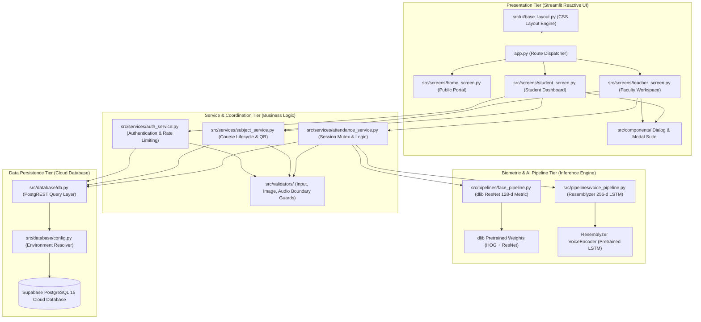
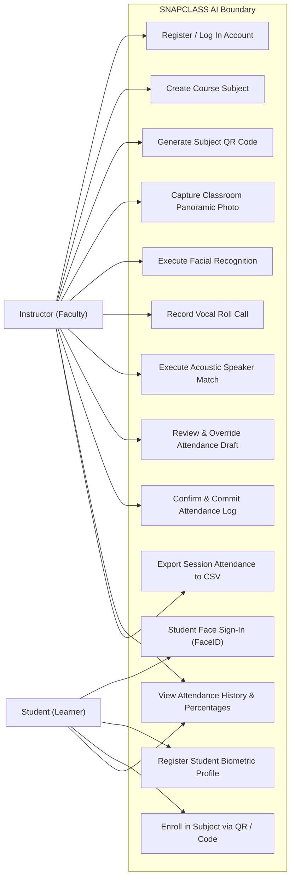
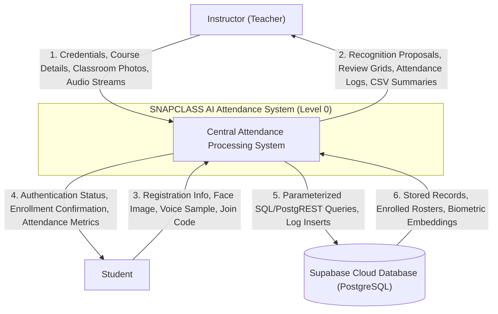
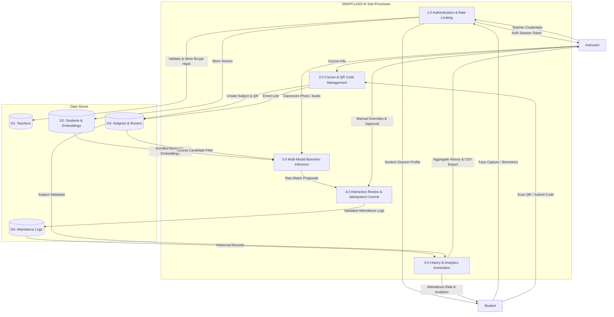
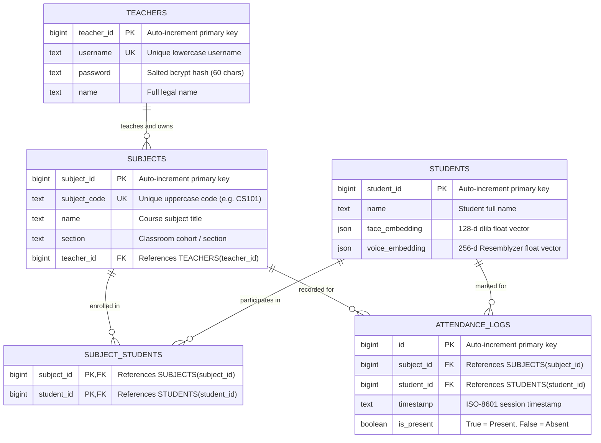
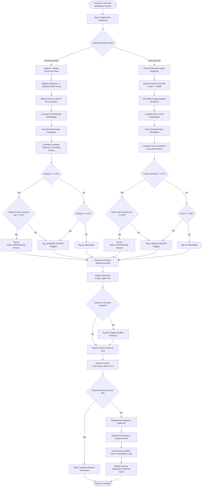
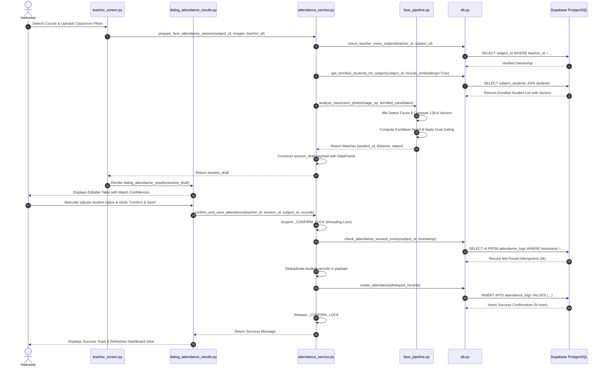

# SNAPCLASS AI — Comprehensive System Diagrams & Technical Schematics

**Course:** B.Tech Computer Science & Engineering  
**Project:** SNAPCLASS AI  
**Document Purpose:** Complete Mermaid diagrams and academic walkthroughs for report insertion.

---

## 1. Overall System Architecture Diagram

This diagram illustrates the 4-tier layered architecture of SNAPCLASS AI, showing the boundaries between presentation, service coordination, biometric inference, and cloud persistence.



---

## 2. Use Case Diagram

This diagram depicts the primary actors (Instructor and Student) and their interactions with the SNAPCLASS AI system boundaries.



---

## 3. Data Flow Diagram (DFD) — Level 0 (Context Level)

The Level 0 Context Diagram shows external entities exchanging raw information with the unified SNAPCLASS AI application boundary.



---

## 4. Data Flow Diagram (DFD) — Level 1 (Decomposition)

The Level 1 DFD decomposes the central system into distinct sub-processes: Authentication, Course & QR Management, Biometric Processing, Review & Commitment, and History Analytics.



---

## 5. Entity-Relationship (ER) Diagram (Relational Database)

This diagram details the relational schema in Supabase PostgreSQL, showing primary keys, foreign keys, cardinality, and data attributes.



---

## 6. Activity Diagram — Classroom Attendance Workflow

This diagram models the dynamic operational steps taken by an instructor to conduct a biometric roll call using classroom photography.



---

## 7. Sequence Diagram — End-to-End Attendance Confirmation

This sequence diagram depicts runtime message passing between actors, UI controllers, background services, biometric inference pipelines, and the cloud PostgreSQL database.



---

## 8. Multi-Modal Recognition Decision Pipeline Architecture

This diagram details the twin metric evaluation engines for facial distance and vocal cosine similarity, showcasing how ambiguous samples are safely quarantined for human review.

```mermaid
flowchart TD
    InputMedia[Classroom Media Capture] --> RouteModality{Sensor Type}

    subgraph FaceEngine ["Facial Biometric Pipeline"]
        RouteModality -- "Visual Image" --> ImageNorm[Image Validation & Lanczos Downscaling]
        ImageNorm --> HOGDetect[HOG Linear SVM Frontal Face Detection]
        HOGDetect --> Align68[68-Point Landmark Facial Alignment]
        Align68 --> ResNet128[ResNet Forward Pass -> 128-d Unit Vector]
        ResNet128 --> NormDiff[Euclidean Metric d = ||x - y||_2]
        NormDiff --> FaceCond1{d <= 0.55?}
        FaceCond1 -- Yes --> FaceGap{Runner-Up Gap (d2 - d1) >= 0.05?}
        FaceGap -- Yes --> FaceHigh["HIGH_CONFIDENCE (Marked Present)"]
        FaceGap -- No --> FaceReview["NEEDS_REVIEW (Lookalike Guard)"]
        FaceCond1 -- No --> FaceCond2{d <= 0.65?}
        FaceCond2 -- Yes --> FaceReview
        FaceCond2 -- No --> FaceUnknown["UNKNOWN (Unidentified Face)"]
    end

    subgraph VoiceEngine ["Voice Biometric Pipeline"]
        RouteModality -- "Acoustic Audio" --> AudioNorm[Audio Validation & 16kHz Resampling]
        AudioNorm --> VADSplit[VAD Split on Non-Silent Frames top_db=25]
        VADSplit --> FilterNoise[Filter Transient Noise < 0.4s]
        FilterNoise --> LSTM256[3-Layer LSTM Forward Pass -> 256-d Unit Vector]
        LSTM256 --> CosineDot[Cosine Similarity S = (u . v) / (||u|| ||v||)]
        CosineDot --> VoiceCond1{S >= 0.72?}
        VoiceCond1 -- Yes --> VoiceGap{Runner-Up Gap (s1 - s2) >= 0.05?}
        VoiceGap -- Yes --> VoiceHigh["HIGH_CONFIDENCE (Marked Present)"]
        VoiceGap -- No --> VoiceReview["NEEDS_REVIEW (Acoustic Ambiguity Guard)"]
        VoiceCond1 -- No --> VoiceCond2{S >= 0.58?}
        VoiceCond2 -- Yes --> VoiceReview
        VoiceCond2 -- No --> VoiceUnknown["UNKNOWN (Unidentified Speaker)"]
    end

    FaceHigh --> ConsensusMerge[Human-in-the-Loop Review Consolidation]
    FaceReview --> ConsensusMerge
    FaceUnknown --> ConsensusMerge
    VoiceHigh --> ConsensusMerge
    VoiceReview --> ConsensusMerge
    VoiceUnknown --> ConsensusMerge

    ConsensusMerge --> InteractiveTable[Interactive Teacher Review Grid]
```
